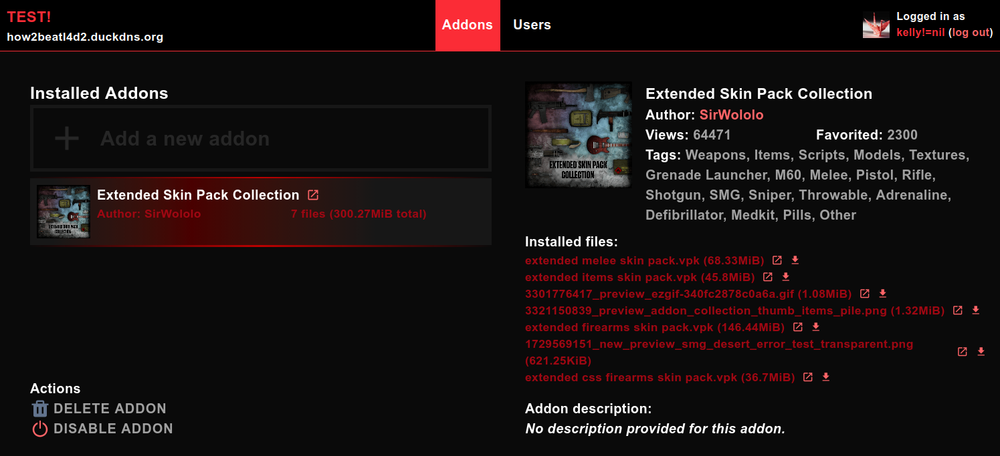
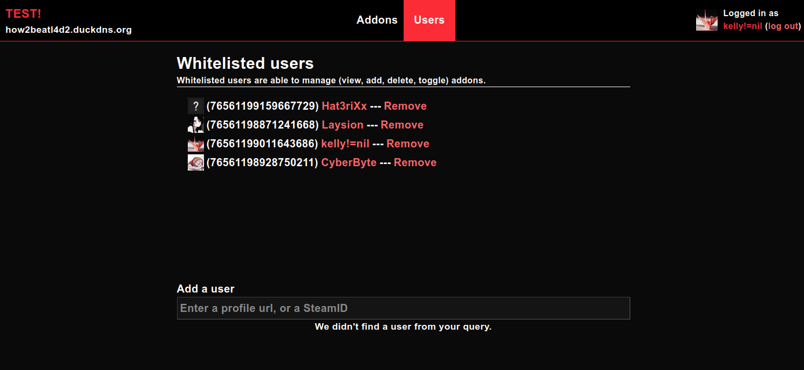
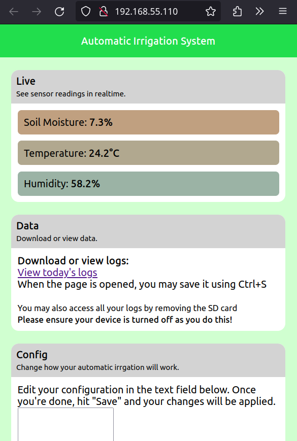
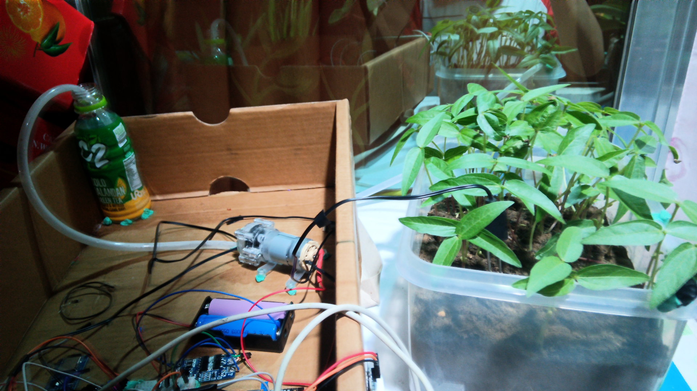
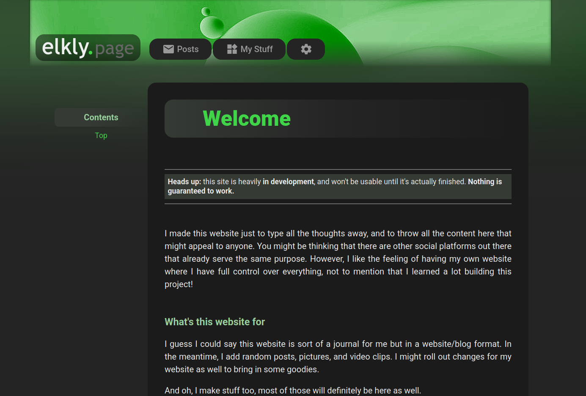

# Hi there!

I am Kelly Neil Ang. I like to turn problems into ideas, and 
to turn those ideas into reality through my creativity, and my 
interest and enthusiasm on anything computing. I started out using 
block-based programming to create games. Fast forward a few years, 
I want to explore how it is like to work with others to create apps 
that benefit people.

## Projects

### (2026) Game Mod Downloader

I often remotely download Steam Workshop files on a different machine, but I often find myself using ssh, curl, and other tools more times than I should, so I thought I would automate that instead.

Then, for the sake learning and partly for fun, I put it on some design and added features I wanted:
- Authorizing specific Steam accounts
- Fecthing description, favorites, views from Steam Workshop
- Simple user management

The project is currently functional, but I continue to look for ways to integrate other technologies like Docker and CLI tools to make the project more convenient for everyone.

#### ● [Demo Video](/moddl-demo.mpg) ● [Source Code](https://github.com/kelly-neil/node-l4d2-server-manager) ● 

|  |  |
| :--: | :--: |
| Managing addons | Whitelisting users to allow access to the app

### (2024) Raspberry Pi Irrigation System

I was the one in our group responsible for the design and programming of our STEM capstone project, the irrigation system.

The microcontroller board is programmed to record sensor readings and to activate the water pump once the soil has become dry. 
Then, a web interface is also served to the local network so that any local devices with a browser can access live and historical data via the dashboard.

#### ● [Source Code](https://github.com/kelly-neil/pico-automatic-irrigation) ●

|  | 
| :--: | :--: |
| Dashboard | Setup of Irrigation System during its development

### (2022-2023) Personal Website

I started this project with my curiosity on how I could achieve a working website from scratch that is live for other people to see. Step by step, I was able to learn  beyond just plain HTML and JavaScript and to other web technologies like PHP, front-end libraries, and WordPress.

I no longer use this website actively, however this is the project that took of my journey in learning web development.

#### ● [Live Website](https://elkly.infinityfreeapp.com/) ●

|  |
| :--: |
| Home page |

